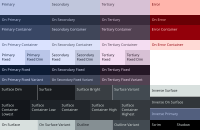

# Netizen

<h2>Palette</h2>

<table>
	<tr>
		<th></th>
		<th>Labels</th>
		<th>Hex</th>
  	<th>RGB</th>
  	<th>HSL</th>
  	<th>OKLCH</th>
	</tr>
  <tr>
    <td></td>
    <td>Primary Primary Fixed Dim</td>
    <td><code>#bac6e9</code></td>
    <td><code>rgb(186, 198, 233)</code></td>
		<td><code>hsl(224.38 51.1% 82.2%)</code></td>
		<td><code>oklch(0.83 0.05 270)</code></td>
	</tr>
	<tr>
		<td></td>
    <td>On Primary</td>
    <td><code>#21304c</code></td>
    <td><code>rgb(33, 48, 76)</code></td>
		<td><code>hsl(218.93 39.9% 21.34%)</code></td>
		<td><code>oklch(0.31 0.055 262)</code></td>
	</tr>
	<b>
		<td></td>
    <td>Primaray Container On Primary Fixed Variant</td>
    <td><code>#394766</code></td>
    <td><code>rgb(57, 71, 102)</code></td>
		<td><code>hsl(221.07 28.1% 31.13%)</code></td>
		<td><code>oklch(0.4 0.055 265)</code></td>
  </tr>
  <tr>
		<td></td>
    <td>On Primary Container Primary Fixed</td>
		<td><code>#d8e0fd</code></td>
    <td><code>rgb(216, 224, 253)</code></td>
    <td><code>hsl(226.72 89.13% 91.93%)</code></td>
		<td><code>oklch(0.91 0.04 273)</code></td>
	</tr>
  <tr>
		<td></td>
    <td>On Primary Fixed</td>
		<td><code>#0d1c35</code></td>
    <td><code>rgb(13, 28, 53)</code></td>
    <td><code>hsl(217.45 60.08% 13.1%)</code></td>
		<td><code>oklch(0.23 0.053 260)</code></td>
	</tr>
  <tr>
    <td></td>
    <td>Secondary Secondary Fixed Dim</td>
    <td><code>#c1c6db</code></td>
    <td><code>rgb(193, 198, 219)</code></td>
		<td><code>hsl(228.39 26.89% 80.9%)</code></td>
		<td><code>oklch(0.83 0.03 275)</code></td>
	</tr>
	<tr>
		<td></td>
    <td>On Secondary</td>
    <td><code>#293042</code></td>
    <td><code>rgb(41, 48, 66)</code></td>
		<td><code>hsl(224.93 22.68% 21.04%)</code></td>
		<td><code>oklch(0.31 0.034 270)</code></td>
	</tr>
	<tr>
		<td></td>
    <td>Secondary Container On Secondary Fixed Variant</td>
    <td><code>#41475a</code></td>
    <td><code>rgb(65, 71, 90)</code></td>
		<td><code>hsl(224.61 16.41% 30.3%)</code></td>
		<td><code>oklch(0.4 0.033 270)</code></td>
  </tr>
  <tr>
		<td></td>
    <td>On Secondary Container Secondary Fixed</td>
		<td><code>#dce2f9</code></td>
    <td><code>rgb(220, 226, 249)</code></td>
    <td><code>hsl(228.38 70.16% 91.99%)</code></td>
		<td><code>oklch(0.915 0.032 275)</code></td>
	</tr>
  <tr>
		<td></td>
    <td>On Secondary Fixed</td>
		<td><code>#151b2c</code></td>
    <td><code>rgb(21, 27, 44)</code></td>
    <td><code>hsl(224.65 35.62% 12.78%)</code></td>
		<td><code>oklch(0.225 0.035 269)</code></td>
	</tr>
  <tr>
    <td></td>
    <td>Secondary Secondary Fixed Dim</td>
    <td><code>#d9c2d6</code></td>
    <td><code>rgb(217, 194, 214)</code></td>
		<td><code>hsl(307.63 23.11% 80.67%)</code></td>
		<td><code>oklch(0.84 0.037 330)</code></td>
	</tr>
	<tr>
		<td></td>
    <td>On Tertiary</td>
    <td><code>#3b2c3c</code></td>
    <td><code>rgb(59, 44, 60)</code></td>
		<td><code>hsl(295.67 15.66% 20.25%)</code></td>
		<td><code>oklch(0.315 0.035 324)</code></td>
	</tr>
	<tr>
		<td></td>
    <td>Tertiary Container On Tertiary Fixed Variant</td>
    <td><code>#524152</code></td>
    <td><code>rgb(82, 65, 82)</code></td>
		<td><code>hsl(299.63 11% 28.85%)</code></td>
		<td><code>oklch(0.4 0.034 326)</code></td>
  </tr>
  <tr>
		<td></td>
    <td>On Tertiary Container Tertiary Fixed</td>
		<td><code>#f4ddf2</code></td>
    <td><code>rgb(244, 221, 242)</code></td>
    <td><code>hsl(304.13 50.29% 91.22%)</code></td>
		<td><code>oklch(0.923 0.037 328)</code></td>
	</tr>
  <tr>
		<td></td>
    <td>On Tertiary Fixed</td>
		<td><code>#251726</code></td>
    <td><code>rgb(37, 23, 38)</code></td>
    <td><code>hsl(297.09 24.46% 11.96%)</code></td>
		<td><code>oklch(0.23 0.035 325)</code></td>
	</tr>
	<tr>
    <td></td>
    <td>On Surface Inverse Surface</td>
		<td><code>#d8e0de</code></td>
    <td><code>rgb(216, 224, 222)</code></td>
    <td><code>hsl(165.38 11.42% 86.27%)</code></td>
		<td><code>oklch(0.9 0.009 180)</code></td>
  </tr>
	<tr>
    <td></td>
    <td>On Surface Variant</td>
		<td><code>#b8c4c4</code></td>
    <td><code>rgb(184, 196, 196)</code></td>
    <td><code>hsl(183.97 9.68% 74.54%)</code></td>
		<td><code>oklch(0.81 0.013 202)</code></td>
  </tr>
  <tr>
    <td></td>
    <td>Outline</td>
		<td><code>#858f93</code></td>
    <td><code>rgb(133, 143, 147)</code></td>
    <td><code>hsl(196.27 6.01% 54.95%)</code></td>
		<td><code>oklch(0.644 0.013 222)</code></td>
  </tr>
	<tr>
    <td></td>
    <td>Surface Variant Outline Variant</td>
		<td><code>#424a51</code></td>
    <td><code>rgb(66, 74, 81)</code></td>
    <td><code>hsl(207.7 9.75% 28.84%)</code></td>
		<td><code>oklch(0.405 0.015 244)</code></td>
  </tr>
	<tr>
    <td></td>
    <td>Surface Bright</td>
		<td><code>#393e43</code></td>
    <td><code>rgb(57, 62, 67)</code></td>
    <td><code>hsl(209.93 8.13% 24.2%)</code></td>
		<td><code>oklch(0.36 0.011 248)</code></td>
  </tr>
  <tr>
    <td></td>
    <td>Surface Surface Dim</td>
		<td><code>#181b1f</code></td>
    <td><code>rgb(24, 27, 31)</code></td>
    <td><code>hsl(213.92 12.77% 10.71%)</code></td>
		<td><code>oklch(0.22 0.009 255)</code></td>
  </tr>
	<tr>
		<td></td>
		<td></td>
		<td></td>
		<td></td>
		<td></td>
		<td></td>
	</tr>
	<tr>
    <td></td>
    <td>Surface Container Highest</td>
		<td><code>#34393e</code></td>
    <td><code>rgb(52, 57, 62)</code></td>
    <td><code>hsl(209.91 8.83% 22.17%)</code></td>
		<td><code>oklch(0.34 0.0111 248)</code></td>
  </tr>
	<tr>
    <td></td>
    <td>Surface Container High</td>
		<td><code>#2c3034</code></td>
    <td><code>rgb(44, 48, 52)</code></td>
    <td><code>hsl(209.93 8.38% 18.64%)</code></td>
		<td><code>oklch(0.305 0.0091 248)</code></td>
  </tr>
	<tr>
    <td></td>
    <td>Surface Container</td>
		<td><code>#22262b</code></td>
    <td><code>rgb(34, 38, 43)</code></td>
    <td><code>hsl(213.93 10.56% 15.12%)</code></td>
		<td><code>oklch(0.267 0.01 255)</code></td>
  </tr>
	<tr>
    <td></td>
    <td>Surface Container Low</td>
		<td><code>#1e2328</code></td>
    <td><code>rgb(30, 35, 40)</code></td>
    <td><code>hsl(209.83 14.39% 13.7%)</code></td>
		<td><code>oklch(0.253 0.012 248)</code></td>
  </tr>
	<tr>
    <td></td>
    <td>Surface Container Lowest</td>
		<td><code>#13161b</code></td>
    <td><code>rgb(19, 22, 27)</code></td>
    <td><code>hsl(217.05 15.78% 9.03%)</code></td>
		<td><code>oklch(0.2 0.01 260)</code></td>
  </tr>
	<tr>
		<td></td>
		<td></td>
		<td></td>
		<td></td>
		<td></td>
		<td></td>
	</tr>
	<tr>
    <td></td>
    <td>Error</td>
		<td><code>#ffb4ab</code></td>
    <td><code>rgb(255, 180, 171)</code></td>
    <td><code>hsl(6.62 99.62% 83.44%)</code></td>
		<td><code>oklch(0.838 0.089 27)</code></td>
  </tr>
	<tr>
    <td></td>
    <td>On Error</td>
		<td><code>#690002</code></td>
    <td><code>rgb(105, 0, 2)</code></td>
    <td><code>hsl(359.15 99.38% 20.7%)</code></td>
		<td><code>oklch(0.328 0.134 28.6)</code></td>
  </tr>
	<tr>
    <td></td>
    <td>Error Container</td>
		<td><code>#93000a</code></td>
    <td><code>rgb(147, 0, 10)</code></td>
    <td><code>hsl(356.24 99.57% 28.87%)</code></td>
		<td><code>oklch(0.417 0.17 27.5)</code></td>
  </tr>
	<tr>
    <td></td>
    <td>On Error Container</td>
		<td><code>#ffdad6</code></td>
    <td><code>rgb(255, 218, 214)</code></td>
    <td><code>hsl(5.68 98.67% 91.83%)</code></td>
		<td><code>oklch(0.917 0.042 25)</code></td>
  </tr>
	<tr>
    <td></td>
    <td>Inverse On Surface</td>
		<td><code>#31363a</code></td>
    <td><code>rgb(49, 54, 58)</code></td>
    <td><code>hsl(206.68 8.51% 21.02%)</code></td>
		<td><code>oklch(0.33 0.01 242)</code></td>
  </tr>
	<tr>
    <td></td>
    <td>Inverse Primary</td>
		<td><code>#525f7e</code></td>
    <td><code>rgb(82, 95, 126)</code></td>
    <td><code>hsl(221.62 21.52% 40.82%)</code></td>
		<td><code>oklch(0.488 0.053 266)</code></td>
  </tr>
	<tr>
    <td></td>
    <td>Shadow Scrim</td>
		<td><code>#000000</code></td>
    <td><code>rgb(0, 0, 0)</code></td>
    <td><code>hsl(0 0% 0%)</code></td>
		<td><code>oklch(0 0 0)</code></td>
  </tr>
</table>

## Installing
[Neovim](https://github.com/ewobee/netizen.nvim)

[Firefox](https://addons.mozilla.org/en-US/firefox/addon/netizen/)

[DuckDuckGo](https://duckduckgo.com/?kae=d&kar=1&kbj=1&k8=c5c8c6&kp=-2&kbg=-1&k21=23262B&kx=c5c8c6&k5=2&k1=-1&kaa=A27BA5&k9=95A6D7&k7=181B1F&kj=23262B&kbc=1&kbe=0&kax=v521-3)
